# 1. Diagramme de cas d'utilisation général

Mermaid n'a pas de diagramme de cas d'utilisation natif : les acteurs sont représentés à gauche, les cas d'utilisation (ovales) regroupés par module, et les flèches indiquent qui réalise quoi.

```mermaid
flowchart LR
    Admin([Administrateur technique])
    Dir([Directeur])
    Sec([Secrétaire])
    Cen([Censeur / Surveillant])
    Ens([Enseignant])
    Comp([Comptable / Caissier])
    Par([Parent])
    Elv([Élève])
    Sys([Système - tâches planifiées])

    subgraph M1[Module 1 — Gestion scolaire]
        UC1(Paramétrer établissement, années, périodes, niveaux, matières)
        UC2(Gérer classes, élèves, responsables, inscriptions)
        UC3(Gérer enseignants, affectations, emplois du temps)
        UC4(Saisir les évaluations et les notes)
        UC5(Faire l'appel, justifier les absences)
        UC6(Publier les bulletins)
    end
    subgraph M2[Module 2 — Espace parents et élèves]
        UC7(Consulter résultats, absences, emploi du temps)
        UC8(Consulter frais, paiements, reçus)
    end
    subgraph M3[Module 3 — Enseignants]
        UC9(Consulter ses classes et matières)
    end
    subgraph M4[Module 4 — Apprentissage]
        UC10(Publier cours et devoirs, corriger)
        UC11(Consulter cours, remettre un devoir)
    end
    subgraph M5[Module 5 — Finances]
        UC12(Configurer frais et échéances)
        UC13(Encaisser un paiement, éditer le reçu)
        UC14(Annuler un paiement, accorder une remise)
        UC15(Enregistrer les dépenses)
        UC16(Consulter rapports et exports)
    end
    subgraph TR[Transverse]
        UC17(Se connecter, changer son mot de passe)
        UC18(Gérer les comptes et le journal d'audit)
        UC19(Publier des annonces)
        UC20(Recevoir des notifications)
        UC21(Consulter le tableau de bord)
    end

    Admin --> UC1 & UC18 & UC19
    Dir --> UC3 & UC6 & UC14 & UC16 & UC19
    Sec --> UC2
    Cen --> UC5 & UC19
    Ens --> UC4 & UC5 & UC9 & UC10
    Comp --> UC12 & UC13 & UC15 & UC16
    Par --> UC7 & UC8
    Elv --> UC7 & UC11
    Sys --> UC20
    Admin & Dir & Sec & Cen & Ens & Comp & Par & Elv --> UC17 & UC20 & UC21
```

Points clés :
- Les rôles sont cumulables ; la matrice exacte est dans [`../roles-permissions.md`](../roles-permissions.md).
- L'administrateur technique n'accède ni aux notes ni aux finances.
- Parents et élèves n'ont aucune permission : leurs accès découlent des Policies (lien responsable–élève, identité de l'élève).
