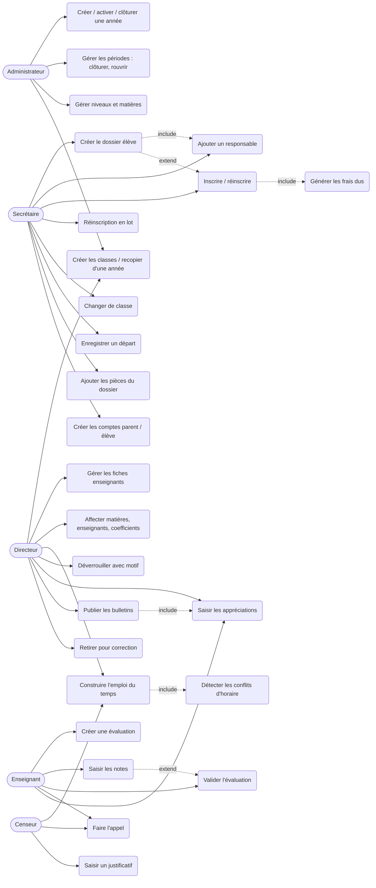
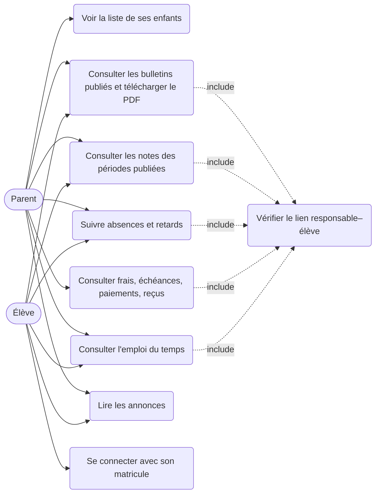
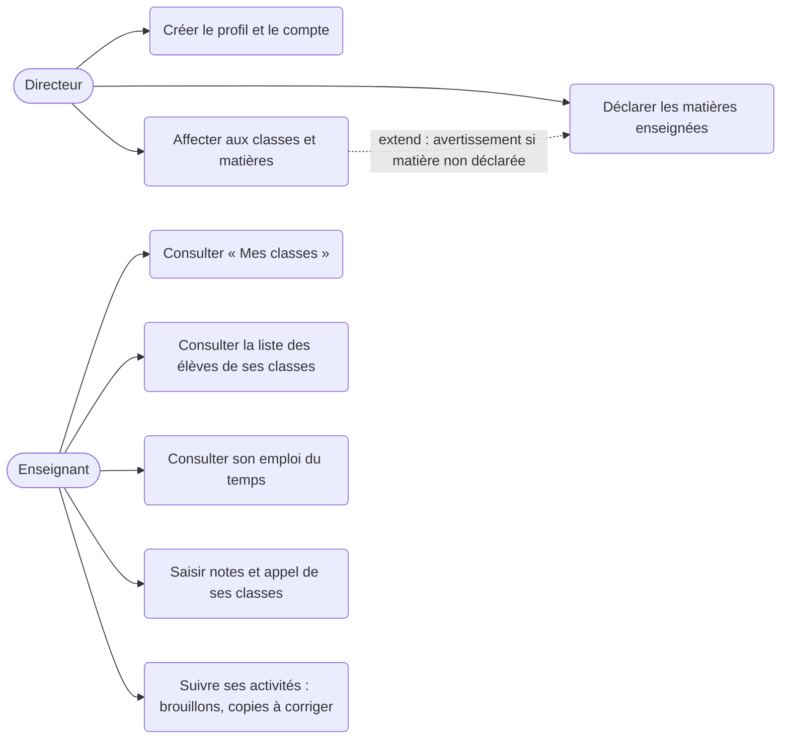
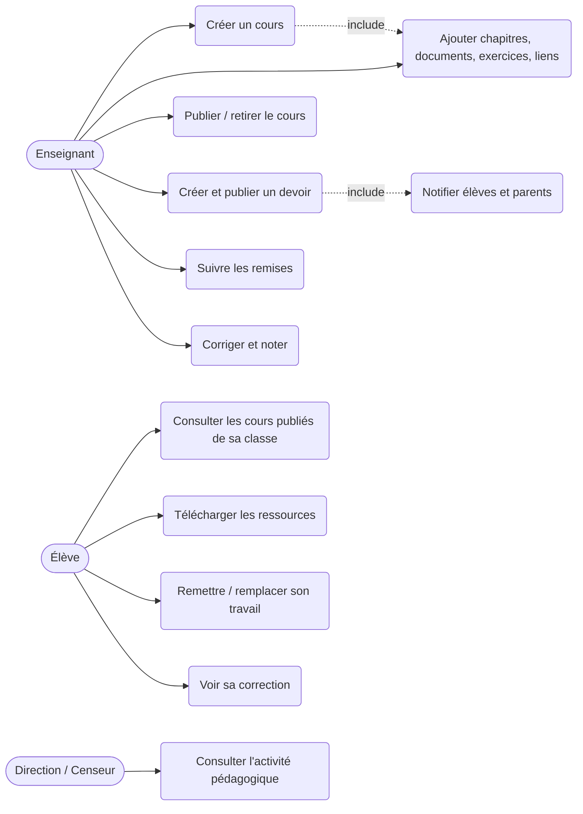
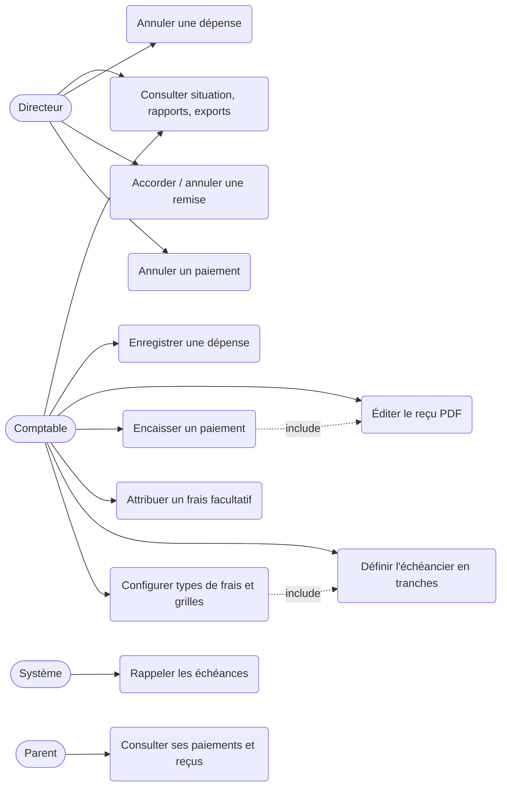

# 2. Cas d'utilisation détaillés par module

`include` = étape obligatoire du cas ; `extend` = variante facultative.

## Module 1 — Gestion scolaire

## Module 2 — Espace parents et élèves

Règle : rien n'est visible avant publication ; l'élève ne voit pas les finances.

## Module 3 — Gestion des enseignants

## Module 4 — Plateforme d'apprentissage

## Module 5 — Gestion financière

