# 3. Diagramme de classes

## 3.1 Modèle du domaine (modèles Eloquent, `app/Models`)

Attributs principaux seulement (le détail des colonnes est dans [08-schema-relationnel.md](08-schema-relationnel.md)). Les énumérations sont dans `app/Enums`.

```mermaid
classDiagram
    direction LR
    class Etablissement {
        +nom
        +devise
        +parametres JSON
        +parametre(cle)
    }
    class User {
        +name
        +email
        +telephone
        +password hache
        +est_actif
        +doit_changer_mot_de_passe
        +aRole(role)
        +estPersonnel()
    }
    class JournalActivite {
        +action
        +anciennes_valeurs
        +nouvelles_valeurs
        +ip
    }
    class AnneeScolaire {
        +libelle
        +date_debut
        +date_fin
        +est_active
        +statut
        +periodePour(date)
    }
    class Periode {
        +libelle
        +ordre
        +date_debut
        +date_fin
        +statut
    }
    class Niveau {
        +libelle
        +cycle
    }
    class Classe {
        +nom
        +serie
        +capacite
        +estPublieePour(periode)
    }
    class Matiere {
        +code
        +libelle
    }
    class Eleve {
        +matricule
        +nom
        +prenoms
        +sexe
        +date_naissance
        +statut
        +elementsManquants()
    }
    class Responsable {
        +nom
        +telephone
        +estResponsableDe(eleve)
    }
    class EleveResponsable {
        +lien
        +est_contact_principal
        +est_payeur
    }
    class Inscription {
        +date_inscription
        +type
        +statut
        +date_sortie
        +categorie_frais
        +redoublant
    }
    class ChangementClasse {
        +date_effet
        +motif
    }
    class DocumentEleve {
        +libelle
        +fichier prive
    }
    class Enseignant {
        +matricule
        +specialite
        +est_actif
        +intervientDans(classe)
    }
    class Affectation {
        +coefficient
        +ordre_bulletin
    }
    class EmploiDuTemps {
        +jour
        +heure_debut
        +heure_fin
        +salle
    }
    class Evaluation {
        +libelle
        +type
        +bareme
        +poids
        +statut
        +deverrouillee_at
    }
    class Note {
        +valeur
        +est_absent
    }
    class Appreciation {
        +appreciation_generale
        +mention
    }
    class Publication {
        +publiee_at
        +depubliee_at
    }
    class Bulletin {
        +moyenne_generale
        +rang
        +mention
        +moyenne_annuelle
        +lignes JSON
        +assiduite JSON
        +version
    }
    class Appel {
        +date_appel
        +creneau
    }
    class Presence {
        +statut
        +minutes_retard
    }
    class Justificatif {
        +date_debut
        +date_fin
        +motif
    }
    class TypeFrais {
        +code
        +est_obligatoire
    }
    class GrilleFrais {
        +categorie
        +montant
    }
    class Tranche {
        +libelle
        +montant
        +date_limite
    }
    class FraisEleve {
        +libelle
        +montant_du
        +date_limite
    }
    class Remise {
        +montant
        +motif
        +annulee_at
    }
    class Paiement {
        +numero_recu
        +montant
        +mode
        +statut
    }
    class Imputation {
        +montant
    }
    class CategorieDepense {
        +libelle
    }
    class Depense {
        +numero
        +montant
        +statut
    }
    class Cours {
        +titre
        +est_publie
    }
    class RessourcePedagogique {
        +type
        +contenu
        +url
    }
    class Devoir {
        +titre
        +date_limite
        +bareme
        +remise_en_ligne
        +accepte_retard
    }
    class RemiseDevoir {
        +remis_at
        +en_retard
        +note
        +correction
    }
    class Annonce {
        +titre
        +cible
        +publiee_at
        +notifiee_at
    }

    AnneeScolaire "1" *-- "1..*" Periode
    AnneeScolaire "1" -- "*" Classe
    Niveau "1" -- "*" Classe
    Classe "1" -- "*" Inscription
    Eleve "1" -- "*" Inscription : une par annee
    AnneeScolaire "1" -- "*" Inscription
    Eleve "1" -- "*" EleveResponsable
    Responsable "1" -- "*" EleveResponsable
    Responsable "0..1" -- "0..1" User : compte parent
    Eleve "0..1" -- "0..1" User : compte eleve
    Enseignant "1" -- "1" User
    Inscription "1" -- "*" ChangementClasse
    Eleve "1" -- "*" DocumentEleve
    Enseignant "0..1" -- "*" Classe : professeur principal
    Classe "1" -- "*" Affectation
    Matiere "1" -- "*" Affectation
    Enseignant "0..1" -- "*" Affectation : titulaire
    Enseignant "*" -- "*" Matiere : matieres enseignees
    Affectation "1" *-- "*" EmploiDuTemps
    Affectation "1" -- "*" Evaluation
    Periode "1" -- "*" Evaluation
    Evaluation "1" -- "*" Note
    Inscription "1" -- "*" Note
    Inscription "1" -- "*" Appreciation
    Classe "1" -- "*" Publication
    Periode "1" -- "*" Publication
    Publication "1" -- "*" Bulletin
    Inscription "1" -- "*" Bulletin : une par periode
    Classe "1" -- "*" Appel
    Appel "1" *-- "*" Presence
    Inscription "1" -- "*" Presence
    Inscription "1" -- "*" Justificatif
    Justificatif "*" -- "*" Presence : excuse
    TypeFrais "1" -- "*" GrilleFrais
    AnneeScolaire "1" -- "*" GrilleFrais
    Niveau "1" -- "*" GrilleFrais
    GrilleFrais "1" *-- "*" Tranche
    Inscription "1" -- "*" FraisEleve : copie de la grille
    FraisEleve "1" -- "*" Remise
    Inscription "1" -- "*" Paiement
    Paiement "1" *-- "1..*" Imputation
    FraisEleve "1" -- "*" Imputation
    CategorieDepense "1" -- "*" Depense
    AnneeScolaire "1" -- "*" Depense
    Affectation "1" -- "*" Cours
    Cours "1" *-- "*" RessourcePedagogique
    Affectation "1" -- "*" Devoir
    Cours "0..1" -- "*" Devoir
    Devoir "1" -- "*" RemiseDevoir
    Inscription "1" -- "*" RemiseDevoir : une par devoir
    Classe "0..1" -- "*" Annonce
    User "1" -- "*" JournalActivite
```

Règles d'intégrité portées par le modèle : `Paiement` et `Depense` ne sont ni modifiés ni supprimés (seulement annulés), `Remise` n'est jamais supprimée, `JournalActivite` est en ajout seul (exceptions levées dans les modèles).

## 3.2 Services métier et contrôle d'accès

Les contrôleurs restent minces : les règles sont dans les services (`app/Services`), les autorisations dans les Policies (`app/Policies`) et les permissions spatie.

```mermaid
classDiagram
    direction TB
    class JournalService {
        +enregistrer(action, sujet, avant, apres)
    }
    class NumerotationService {
        +suivant(cle) verrou SQL
        +matricule()
        +recu()
        +depense()
    }
    class CompteService {
        +creer()
        +modifier()
        +reinitialiserMotDePasse()
    }
    class EleveService {
        +creer()
        +rattacher()
        +creerCompteParent()
        +creerCompteEleve()
    }
    class InscriptionService {
        +inscrire()
        +changerClasse()
        +enregistrerDepart()
    }
    class FraisService {
        +genererObligatoires()
        +attribuer()
        +enregistrerGrille()
    }
    class AffectationService {
        +ajouter()
        +mettreAJour()
        +copier()
    }
    class EmploiDuTempsService {
        +ajouter()
        +conflits()
    }
    class AppelService {
        +enregistrer()
        +peutModifier()
        +totaux()
    }
    class EvaluationService {
        +creer()
        +saisirNotes()
        +valider()
        +deverrouiller()
    }
    class MoyenneService {
        +moyenneMatiere()
        +moyenneGenerale()
        +rangs()
        +resultatsClasse()
    }
    class BulletinService {
        +publier()
        +depublier()
    }
    class SoldeService {
        +situation()
        +soldes()
    }
    class PaiementService {
        +encaisser()
        +annuler()
    }
    class RemiseService {
        +accorder()
        +annuler()
    }
    class DepenseService {
        +enregistrer()
        +annuler()
    }
    class ApprentissageService {
        +enregistrerDevoir()
        +publierDevoir()
        +remettre()
        +corriger()
    }
    class SuiviEleveService {
        +bulletinsPublies()
        +notesPubliees()
    }
    class AnnonceService {
        +publier()
        +diffuser()
    }
    class RappelEcheanceService {
        +envoyer()
    }
    class PasserellePaiement {
        <<interface>>
        +initier()
        +verifierNotification()
    }
    EleveService --> NumerotationService
    EleveService --> CompteService
    InscriptionService --> FraisService
    BulletinService --> MoyenneService
    BulletinService --> AppelService
    PaiementService --> NumerotationService
    PaiementService --> SoldeService
    RemiseService --> SoldeService
    DepenseService --> NumerotationService
    RappelEcheanceService --> SoldeService
    SuiviEleveService --> SoldeService
    AffectationService --> EmploiDuTempsService
    PasserellePaiement ..> PaiementService : integration future
```

Policies : `ElevePolicy` (dossier, suivi famille), `ClassePolicy`, `EvaluationPolicy`, `BulletinPolicy`, `PaiementPolicy`, `CoursPolicy`, `DevoirPolicy`. Tous les services qui modifient des données sensibles écrivent dans `JournalService` (dépendance omise pour la lisibilité).
