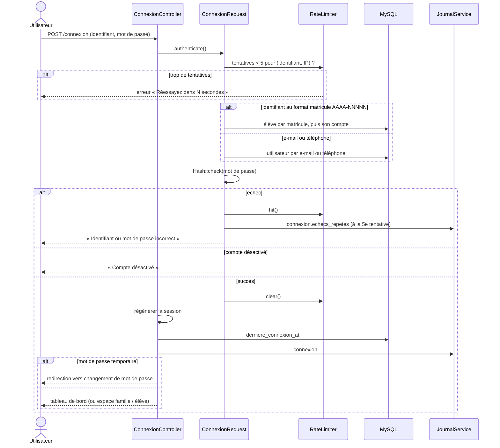
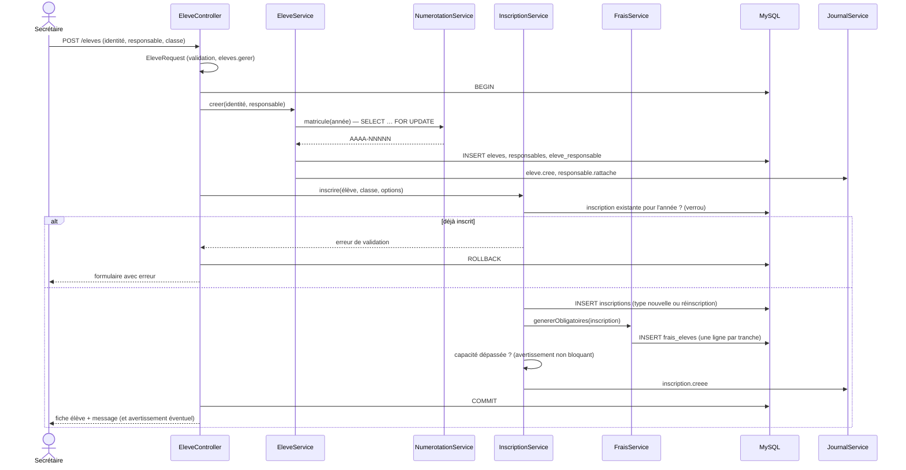
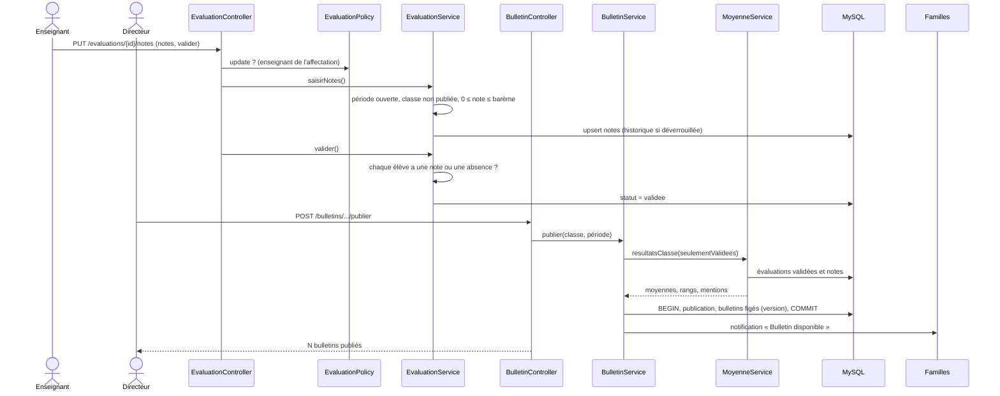
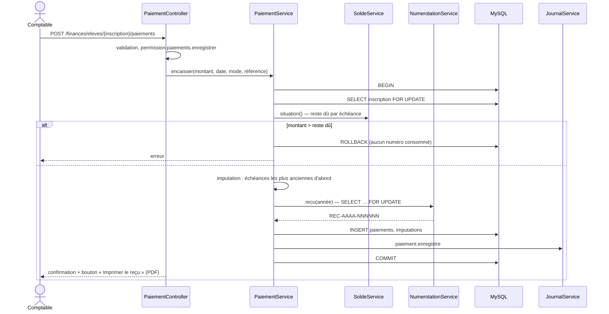
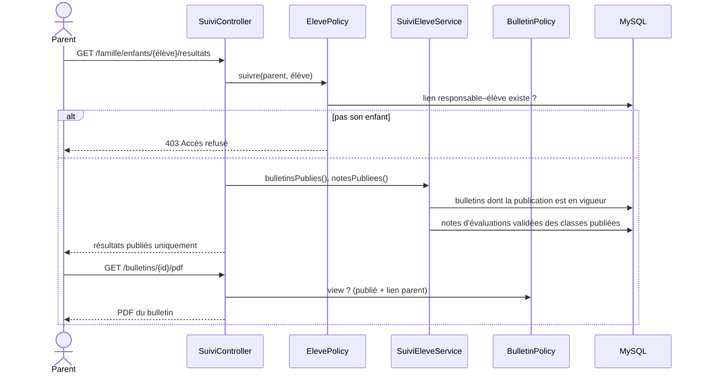
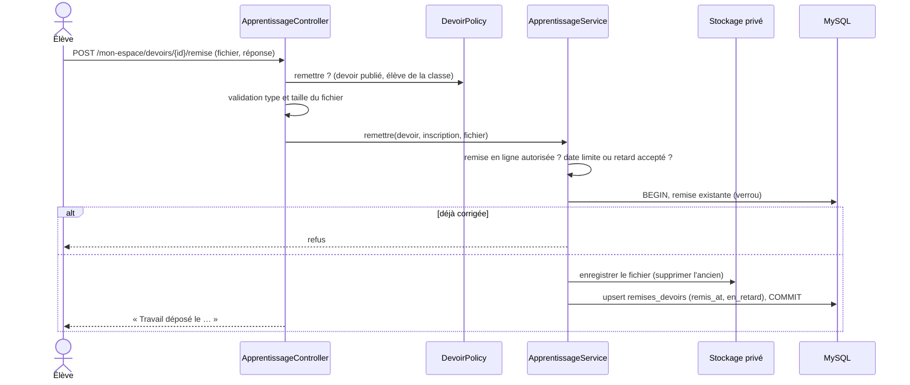

# 4. Diagrammes de séquence

## 4.1 Authentification

## 4.2 Inscription d'un élève

## 4.3 Saisie et publication des notes

## 4.4 Enregistrement d'un paiement

## 4.5 Consultation des résultats par un parent

## 4.6 Remise d'un devoir par un élève

