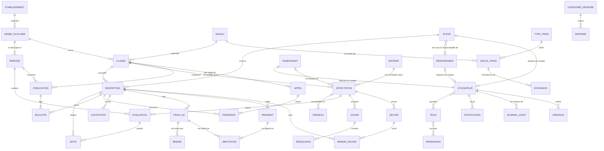

# 6. Modèle conceptuel des données (MCD)

Entités et associations avec leurs cardinalités, indépendamment de l'implémentation. Notation Mermaid « entité-association » : `||` exactement un, `o|` zéro ou un, `|{` un ou plusieurs, `o{` zéro ou plusieurs.

## Choix de modélisation

- **L'inscription (élève × année) est l'entité pivot** : notes, présences, frais, paiements, bulletins et devoirs s'y rattachent. L'historique d'un élève reste exact quand il change de classe ou d'année.
- **Parent = Responsable** : un responsable légal peut suivre plusieurs enfants, un enfant peut avoir plusieurs responsables. Le compte de connexion est facultatif.
- **Valeurs calculées non stockées** : les soldes (frais dus − remises − paiements valides) et les moyennes sont recalculés. **Exception explicite** : le bulletin publié est un instantané figé et versionné, pour que le document remis aux familles ne change pas sans republication tracée.
- **Pas de suppression des opérations financières** : paiement, remise et dépense portent un statut d'annulation.
